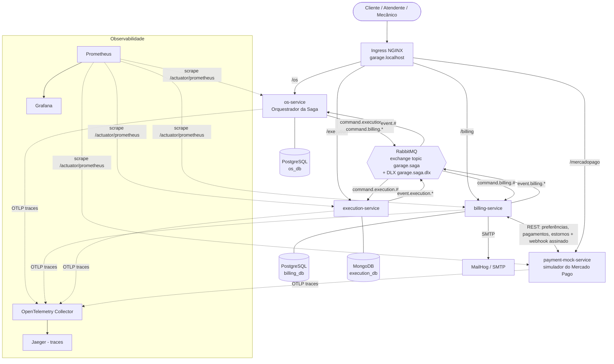
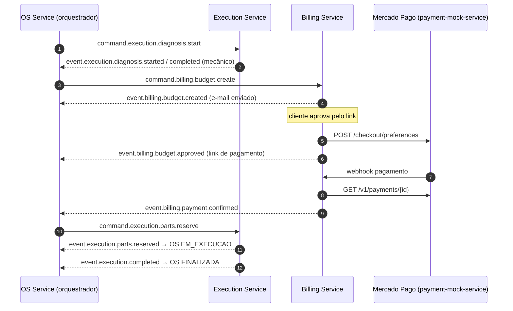

# Garage System — Fase 4: Microsserviços + Saga Pattern

Infraestrutura compartilhada e documentação geral da oficina mecânica refatorada para **microsserviços**.

| Repositório | Responsabilidade | Banco | Porta |
|---|---|---|---|
| [`os-service`](https://github.com/pedrocmoreira/os-service) | Ordem de Serviço, cadastros, histórico e **orquestrador da Saga** | PostgreSQL | 8081 |
| [`billing-service`](https://github.com/pedrocmoreira/billing-service) | Orçamento, aprovação do cliente e pagamento **Mercado Pago** | PostgreSQL | 8082 |
| [`execution-service`](https://github.com/pedrocmoreira/execution-service) | Fila de execução, diagnóstico, reparo e estoque de peças | **MongoDB** | 8083 |
| [`payment-mock-service`](https://github.com/pedrocmoreira/payment-mock-service) | **Simulador do Mercado Pago** (preferências, pagamentos, estornos, webhook assinado) | em memória | 8084 |
| [`garage-infra`](https://github.com/pedrocmoreira/garage-infra) (este) | docker-compose, Kubernetes da infra, observabilidade, Postman, docs | — | — |

## Arquitetura



**Regras de comunicação:**
- **Nenhum serviço acessa o banco de outro.** Cada um tem banco próprio (2× PostgreSQL + 1× MongoDB).
- **Assíncrona (RabbitMQ)** para todo o fluxo transacional (comandos e eventos da Saga), com retry e **DLQ** por fila.
- **REST síncrono** para interação com usuários (APIs de cada serviço), para o provedor de pagamento e para o webhook.
- O provedor de pagamento é o **`payment-mock-service`**, um repositório separado que imita o contrato HTTP do Mercado Pago
  (por orientação do professor). Para usar o Mercado Pago real, basta trocar `MP_API_BASE_URL`/`MP_ACCESS_TOKEN` no `.env`.
- O JWT é emitido pelo OS Service e validado pelos demais com o segredo compartilhado (`JWT_SECRET`).

## Saga Pattern — estratégia escolhida: **Orquestração**



### Compensações (rollback distribuído)
| Falha | Compensações disparadas pelo orquestrador | Estado final |
|---|---|---|
| Cliente recusa o orçamento | `command.execution.cancel` + `command.billing.budget.cancel` | OS `CANCELADA`, saga `COMPENSATED` |
| Pagamento recusado | `command.execution.cancel` + `command.billing.budget.cancel` | OS `CANCELADA`, saga `COMPENSATED` |
| Falta de peças após pagamento | `command.execution.cancel` + `command.billing.payment.refund` (estorno MP) | saga `COMPENSATING` → `COMPENSATED` ao receber `payment.refunded` |
| Cancelamento manual (`POST /cancel`) | conforme as etapas já efetivadas | OS `CANCELADA` |

O estado da saga (`saga_instances`) registra a etapa atual e **quais etapas já tiveram efeito** (`budgetCreated`,
`paymentConfirmed`, `partsReserved`). Assim, somente o que realmente aconteceu é compensado, em ordem inversa.

### Por que orquestração e não coreografia?
1. **O fluxo tem dono natural:** o ciclo de vida da OS pertence ao OS Service, que já mantinha a máquina de estados na Fase 1.
2. **Compensações dependem do histórico da saga:** estornar ou apenas cancelar depende do que já aconteceu. Um orquestrador com
   estado persistido decide isso em um único lugar; na coreografia, essa lógica ficaria espalhada entre os serviços.
3. **Rastreabilidade:** `GET /api/service-orders/{id}/saga` mostra etapa, status e motivo da falha. Isso facilita a operação
   em várias filiais e a demonstração.
4. **Baixo acoplamento preservado:** Billing e Execution não conhecem o fluxo. Eles apenas executam comandos e publicam fatos,
   e a comunicação continua assíncrona.

Trade-off aceito: o orquestrador é um ponto central. Mitigamos isso com estado persistido, consumo idempotente
(`processed_messages`), publicação após o commit, retry e DLQ.

### Confiabilidade
- **Idempotência:** o orquestrador registra `messageId` processados; Billing e Execution reconhecem comandos repetidos
  (orçamento/fila já existentes, reserva já feita, notificação de pagamento já final).
- **Retry + DLQ:** 3 tentativas com backoff exponencial; depois a mensagem vai para `<fila>.dlq`.
- **Publicação pós-commit:** comandos/eventos só saem após o commit da transação local.

## Tecnologias e justificativas
| Tecnologia | Uso | Por quê |
|---|---|---|
| Java 21 + Spring Boot 4 | Os 3 serviços | Continuidade com as fases anteriores; Spring AMQP, Data JPA/Mongo, Security |
| PostgreSQL | OS e Billing | Dados transacionais e financeiros: ACID, integridade referencial, Flyway |
| MongoDB | Execution | Documentos com listas variáveis e linha do tempo; esquema flexível |
| RabbitMQ (topic exchange) | Saga | Roteamento por routing key (`command.*`/`event.*`), DLX nativo, simples de operar |
| Mercado Pago Checkout Pro (simulado) | Pagamentos | `payment-mock-service` replica o contrato (preferências, webhook com `x-signature`, estorno); troca para o real só por configuração |
| OpenTelemetry + Jaeger | Tracing distribuído | Um trace atravessa HTTP → RabbitMQ → serviços (contexto propagado nas mensagens) |
| Prometheus + Grafana | Métricas | Métricas de negócio (`garage_saga_*`, pagamentos, reservas) + HTTP/RabbitMQ |
| Logs JSON (ECS) | Logs | `traceId`/`spanId` em cada linha, correlacionando logs e traces |
| GitHub Actions + GHCR + kind/K8s | CI/CD | Pipeline independente por repositório, imagem versionada pelo SHA |
| JaCoCo + SonarCloud + Cucumber | Qualidade | Gate de 80%, Quality Gate e BDD do fluxo completo |

## Como executar

### 1. Docker Compose (tudo local)
```bash
# repositórios lado a lado: os-service/ billing-service/ execution-service/ payment-mock-service/ garage-infra/
cd garage-infra
cp .env.example .env        # preencha senhas, JWT_SECRET (>= 32 chars), MP_ACCESS_TOKEN e MP_WEBHOOK_SECRET
docker compose up -d --build
./scripts/e2e-saga.sh        # executa os 4 cenários da Saga (feliz + 3 falhas) e valida os estados
```
| Ferramenta | URL |
|---|---|
| Swagger | <http://localhost:8081/swagger-ui.html> · <http://localhost:8082/swagger-ui.html> · <http://localhost:8083/swagger-ui.html> · <http://localhost:8084/swagger-ui.html> |
| Simulador Mercado Pago (pagamentos e webhooks entregues) | <http://localhost:8084/api/mock/payments> |
| RabbitMQ | <http://localhost:15672> |
| MailHog (e-mails de orçamento) | <http://localhost:8025> |
| Jaeger | <http://localhost:16686> |
| Prometheus | <http://localhost:9090> |
| Grafana (dashboard “Garage System - Saga e Microsserviços”) | <http://localhost:3000> (porta `GRAFANA_PORT`) |

### 2. Kubernetes (kind)
```bash
./scripts/deploy-kind.sh     # cria o cluster, ingress, secrets (a partir do .env), infra, observabilidade e os 3 serviços
```
- Manifestos de infra: `k8s/infra` (namespace, StatefulSets dos bancos e RabbitMQ, MailHog, Ingress) e
  `k8s/observability` (OTel Collector, Jaeger, Prometheus com service discovery, Grafana).
- Manifestos de cada serviço ficam no próprio repositório (`k8s/`), aplicados pela pipeline dele.
- Checkout do simulador exposto em `http://garage.localhost/mercadopago`.
- **Segredos**: nunca versionados. `scripts/create-secrets.sh` cria o Secret `garage-secrets` a partir do `.env`.

### 3. Postman
`postman/garage-fase4.postman_collection.json`: fluxo feliz, falta de peças com estorno, orçamento recusado, pagamento recusado
e cancelamento manual. Configure a variável `password` e rode a collection inteira no *Runner* com *delay* de 1500 ms.

## Qualidade (SonarCloud)
Projetos públicos em <https://sonarcloud.io/organizations/pedrocmoreira/projects>. A pipeline de cada serviço envia a análise
(com a cobertura do JaCoCo) e falha se o Quality Gate não passar.

## Documentos
- `docs/entrega-fase4.md` — conteúdo do PDF a ser entregue no portal.
- `docs/roteiro-video.md` — roteiro do vídeo de até 15 minutos.
- `docs/branch-protection.md` — proteção da branch `main` (PR obrigatório + checks).
